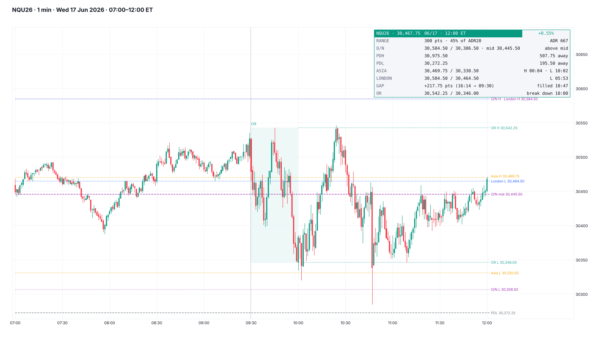
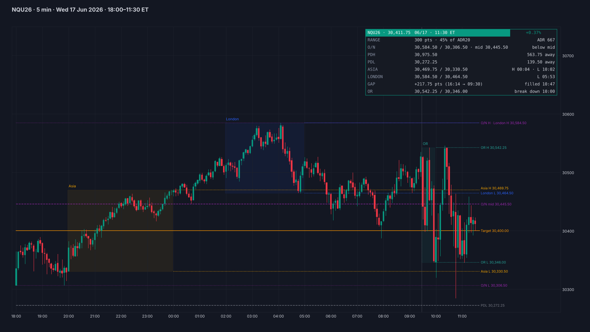
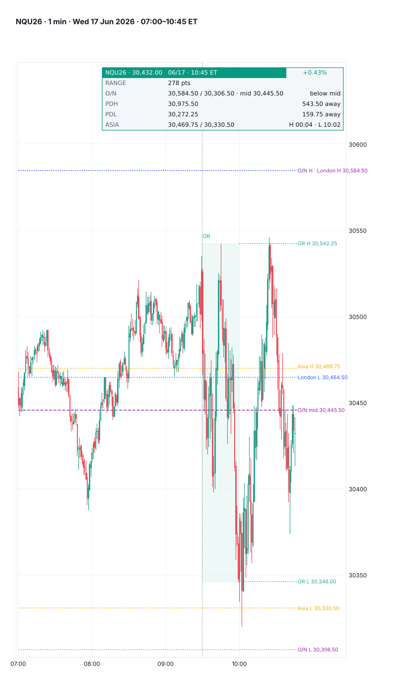

# mockup

**TradingView-style chart mock-ups of any futures day, from 1-minute CSVs, for visual back-testing.** Render one morning, or every trading day in a range, then flip through the pictures and mark what happened.



## No look-ahead

Everything on the chart and the card is built only from bars up to `--end`. Move `--end` forward and the day replays exactly as it looked at that moment, which is what makes it usable for honest box testing.

## Use

```bash
python mockup.py --data "nq/*.csv" --date 2026-06-17
python mockup.py --data "nq/*.csv" --date 2026-06-01..2026-06-30 --out june/      # one PNG per trading day
python mockup.py --data "nq/*.csv" --date 2026-06-17 --start 08:00 --end 10:15 --tf 5 --theme dark
python mockup.py --data "nq/*.csv" --date 2026-06-17 --level 30400:Target --level 30250:Stop:#f23645
python mockup.py --data "nq/*.csv" --date last --layout mobile
```

| Option | Default | |
|---|---|---|
| `--date` | `last` | a day, a range `A..B`, or `last` |
| `--start`, `--end` | `07:00`, `12:00` | the window in ET; 18:00 or later means the evening before |
| `--tf` | `1` | candle minutes |
| `--show` | all | `pdhl,overnight,asia,london,or,open` |
| `--level` | | extra line `PRICE[:LABEL[:#COLOR]]`, repeatable |
| `--card` | `auto` | `auto`, `none`, or a JSON file `{"title", "pill", "color", "rows": [[key, value, right], ...]}` |
| `--theme`, `--layout` | `light`, `desktop` | `dark`, `mobile` |
| `--tz-shift` | auto | hours added to file times (+1 for Barchart Central time, 0 otherwise) |

## What it draws

- Prior day's high and low.
- The overnight (18:00–09:29) high, low and midpoint.
- The Asia (20:00–00:00) and London (02:00–05:00) sessions as boxes, with their highs and lows carried right.
- The opening range (09:30–09:59) and the 09:30 line.
- Your own levels. Labels at the same price share one label.

**The auto card:**
- today's range against ADR20;
- the overnight range and which side of its midpoint price is on;
- PDH and PDL, taken (with the time) or the distance to each;
- Asia and London highs and lows, and when each was taken;
- the RTH gap (16:14 close → 09:30 open) and when it filled;
- the opening-range break and its time.

## Data

Any mix of:
- **Barchart continuous export:** `Date,Time,Open,High,Low,Close,...,Volume,Contract` (US Central, shifted +1 h to ET).
- **Barchart per-contract file:** `Time,Open,High,Low,Latest,...,Volume` (the contract comes from the file name, e.g. `nqz26_...`).
- **Generic CSV:** a date / time column (or unix-seconds `time`, as TradingView exports) plus open, high, low, close and optional volume.

A trading day runs 18:00 (the evening before) to 17:00 ET. When several contracts trade the same day, the one with the most volume is used.

Requires Python 3.9+, numpy, pandas and matplotlib.

## More examples





## Licence

Mozilla Public License 2.0, see [LICENSE](LICENSE). © Unclehk2000.
